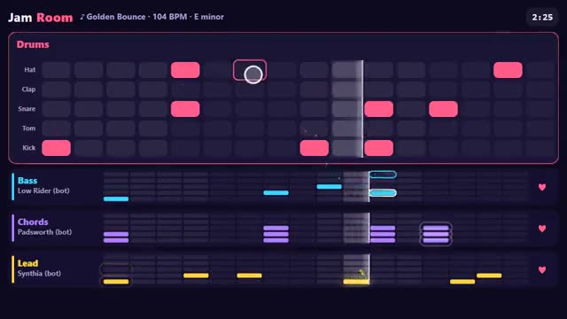

# Jam Room

Grab an instrument. Make a beat together. A multiplayer starter game from [Multiplayer Agent](https://multiplayeragent.com): 2D, party, 1–8 players, with bots that fill empty seats.

## How it plays

One loop plays for everyone at the same time. You play one of four instruments (drums, bass, chords or lead): tap squares to add notes and hear them land on the next beat. Cheer the parts you like; every song gets a fresh key and tempo.

**Controls:** Click or tap squares to add or remove notes (drag to paint a run); tap another instrument to switch, ♥ to cheer.

## Make it yours in the Game Builder

Open the [Game Builder](https://multiplayeragent.com), choose **Start from a starter game** and pick Jam Room. It opens as version 1 in your studio, ready to play and publish. Then ask for changes, for example:

- Add a fifth instrument: a cowbell row
- Let players pick the scale before a song
- Make the loop 32 steps long

## Run it yourself

1. Get a free publishable key (`pk_…`) at [multiplayeragent.com](https://multiplayeragent.com).
2. In `index.html`, put it in place of `pk_REPLACE_ME` in the `MP_CONNECT` block.
3. Open `index.html` in a browser. No build step and no server needed.

Without a key it still runs, offline against bots.

## How it is built

- One `index.html`. The comment at the top of the script maps the code and explains the multiplayer. All sound is made in the browser with WebAudio: each song's key, chords and starting grooves come from a seed, and every row of the bass, chords and lead plays a note that fits, so any pattern sounds musical.
- **Host-run rules:** One player's browser keeps the band's patterns and seats and applies every note; if it leaves, the next player takes over.
- **Live sync:** Everyone hears the same loop on a shared clock and sees every note as it's added.
- **Bots:** Bots play the instruments nobody has taken, changing their parts a little every few seconds.
- **Leaderboard:** The most cheers each player got in one song.
- **Live ops:** Set the tempo or the song length for every room without touching code.
- `?attract` runs it offline with bots and an autopilot on your instrument. The preview video is recorded from it.

## License

MIT.
